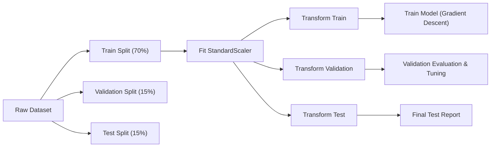

# HousePrice AI — House Price Prediction from Scratch

[](https://www.python.org/downloads/)
[](https://numpy.org/)
[](https://opensource.org/licenses/MIT)
[]()

> A complete, educational machine learning engineering project predicting residential house prices using **Multiple Linear Regression and Batch Gradient Descent implemented entirely from scratch using only NumPy and Pandas**.
> Built without Scikit-learn, PyTorch, TensorFlow, or statsmodels to demonstrate foundational mathematical and algorithmic understanding.

---

## Table of Contents
1. [Project Overview](#1-project-overview)
2. [Problem Statement](#2-problem-statement)
3. [Dataset Description](#3-dataset-description)
4. [Technology Stack](#4-technology-stack)
5. [Project Architecture & File Tree](#5-project-architecture--file-tree)
6. [Installation & Setup](#6-installation--setup)
7. [Dataset Setup Instructions](#7-dataset-setup-instructions)
8. [Pipeline Execution](#8-pipeline-execution)
   - [Training the Model (`train.py`)](#training-the-model-trainpy)
   - [Running Predictions (`predict.py`)](#running-predictions-predictpy)
   - [Running Unit Tests](#running-unit-tests)
   - [Interactive Notebooks](#interactive-notebooks)
9. [Mathematical Foundations](#9-mathematical-foundations)
   - [Multiple Linear Regression Model](#multiple-linear-regression-model)
   - [Loss Function: Mean Squared Error (MSE)](#loss-function-mean-squared-error-mse)
   - [Gradient Descent Derivation](#gradient-descent-derivation)
   - [L2 Regularization (Ridge Regression)](#l2-regularization-ridge-regression)
   - [Evaluation Metrics Formulas](#evaluation-metrics-formulas)
   - [Feature Standardization](#feature-standardization)
10. [Training & Testing Methodology](#10-training--testing-methodology)
11. [Hyperparameter & Engineering Experiments](#11-hyperparameter--engineering-experiments)
12. [Model Limitations](#12-model-limitations)
13. [Future Improvements](#13-future-improvements)
14. [License](#14-license)

---

## 1. Project Overview

**HousePrice AI** is an end-to-end machine learning project designed for computer science and data science students seeking deep, first-principles mastery of predictive modeling. Rather than treating machine learning algorithms as black-box libraries, this project implements:

- **Custom Multiple Linear Regression** vectorized in NumPy.
- **Custom Batch Gradient Descent** with analytical weight and bias gradient computation.
- **Custom Feature Scaler (`StandardScaler`)** computing z-scores with variance validation.
- **Custom Evaluation Suite** implementing MAE, MSE, RMSE, and $R^2$ from mathematical definitions.
- **Custom Train/Val/Test Splitter** utilizing pseudo-random permutations with zero-leakage guarantees.
- **Model Persistence Engine** storing trained model weights, biases, and normalization parameters in JSON format.

---

## 2. Problem Statement

Residential property valuation is influenced by diverse continuous and ordinal variables, such as square footage, construction year, and quality grade. The objective is to build a multiple linear regression model that predicts the final sale price (`SalePrice`) of a single-family home given its characteristics:

$$\hat{y} = f(x_1, x_2, \dots, x_n) = Xw + b$$

Accurate estimation provides homeowners, appraisers, and mortgage lenders with objective valuation benchmarks while revealing the marginal contribution of individual property features.

---

## 3. Dataset Description

The project is built around the **Kaggle Ames Housing Dataset**:
- **Competition:** [House Prices: Advanced Regression Techniques](https://www.kaggle.com/competitions/house-prices-advanced-regression-techniques)
- **Observations:** 1,460 residential properties sold in Ames, Iowa between 2006 and 2010.
- **Total Raw Columns:** 81 (79 explanatory features, 1 target variable `SalePrice`, and 1 `Id` column).
- **Target Variable:** `SalePrice` (Continuous, in USD).

### Primary Baseline Features
For the initial baseline model, six key numerical drivers are selected:
| Feature | Type | Description |
| :--- | :--- | :--- |
| `GrLivArea` | Continuous | Above-grade (ground level) living area in square feet |
| `OverallQual` | Discrete / Ordinal | Rates the overall material and finish of the house (1–10) |
| `YearBuilt` | Discrete | Original construction year |
| `BedroomAbvGr` | Discrete | Bedrooms above grade level (excludes basement bedrooms) |
| `FullBath` | Discrete | Full bathrooms above grade |
| `GarageCars` | Discrete | Garage capacity measured in vehicles |

### Additional Engineered Features
- `HouseAge`: $2010 - \text{YearBuilt}$ (Age in years relative to dataset collection).
- `AreaPerBedroom`: $\frac{\text{GrLivArea}}{\max(1, \text{BedroomAbvGr})}$ (Living density).
- `TotalBathrooms`: $\text{FullBath} + 0.5 \times \text{HalfBath}$.
- `TotalSF`: $\text{TotalBsmtSF} + \text{1stFlrSF} + \text{2ndFlrSF}$.

---

## 4. Technology Stack

### Allowed Libraries
- **Python 3.10+**: Core programming language.
- **NumPy**: Matrix multiplications, vectorized operations, gradient calculations, and array permutations.
- **Pandas**: Structured CSV loading, data cleaning, and data exploration.
- **Matplotlib**: Non-interactive (`Agg`) plot generation and loss diagnostics.
- **Python Standard Library**: `json`, `os`, `sys`, `pathlib`, `argparse`, `unittest`, `tempfile`.

### Strict Rule Compliance
- **No Scikit-learn** (`sklearn.linear_model`, `sklearn.preprocessing`, `sklearn.model_selection`, `sklearn.metrics` are strictly prohibited).
- **No Deep Learning Frameworks** (PyTorch, TensorFlow, Keras, JAX).
- **No Gradient Boosters** (XGBoost, LightGBM, CatBoost).
- **No Statsmodels** regression solvers.
- **No Pre-made solvers** (e.g. `numpy.linalg.lstsq` or `numpy.polyfit` are not used for model training).

---

## 5. Project Architecture & File Tree

```
ML_LAB_PROJECT/
│
├── data/
│   ├── raw/
│   │   └── train.csv                       # Expected Kaggle training CSV
│   ├── processed/
│   │   └── splits_baseline.npz             # Processed train/val/test NumPy splits
│   └── House Price Prediction Dataset.csv  # Fallback sample dataset
│
├── notebooks/
│   ├── 01_data_exploration.ipynb           # EDA, distributions, correlation matrix
│   ├── 02_data_preprocessing.ipynb         # Cleaning, feature engineering, scaling
│   ├── 03_linear_regression_from_scratch.ipynb  # Math derivations & synthetic tests
│   ├── 04_model_training.ipynb             # Target scaling, GD training, loss curves
│   ├── 05_model_evaluation.ipynb           # Residual diagnostics, test set evaluation
│   └── 06_experiments.ipynb                # LR tuning, epochs, log target, L2 penalty
│
├── src/
│   ├── __init__.py                         # Package declaration
│   ├── data_loader.py                      # CSV loading and DataFrame inspection
│   ├── preprocessing.py                    # StandardScaler, missing value handling
│   ├── feature_engineering.py              # HouseAge, AreaPerBedroom, TotalSF
│   ├── data_split.py                       # 70/15/15 pseudo-random split with no overlap
│   ├── linear_regression.py                # LinearRegressionScratch with Batch GD & L2
│   ├── metrics.py                          # MAE, MSE, RMSE, R2 from scratch
│   ├── visualization.py                    # Plotting functions using Matplotlib
│   └── model_io.py                         # JSON serialization & reconstruction
│
├── models/
│   └── linear_regression.json              # Trained weights, bias, scaler metadata
│
├── outputs/
│   ├── eda/                                # Correlation heatmap, distributions
│   ├── training/                           # Loss curves, train vs val loss plots
│   └── evaluation/                         # Actual vs predicted, residual plots
│
├── tests/
│   ├── __init__.py
│   ├── test_regression.py                  # LinearRegressionScratch & StandardScaler tests
│   ├── test_metrics.py                     # MAE, MSE, RMSE, R2 manual tests
│   └── test_model_io.py                    # JSON save/load parameter consistency tests
│
├── train.py                                # Automated end-to-end training pipeline
├── predict.py                              # CLI / interactive inference script
├── requirements.txt                        # Minimal external dependencies
├── README.md                               # Comprehensive documentation
└── .gitignore                              # Git exclusion patterns
```

---

## 6. Installation & Setup

1. **Clone the repository:**
   ```bash
   git clone https://github.com/your-username/HousePrice-AI.git
   cd HousePrice-AI
   ```

2. **Create and activate a virtual environment (recommended):**
   ```bash
   python -m venv venv
   # On Windows:
   .\venv\Scripts\activate
   # On macOS/Linux:
   source venv/bin/activate
   ```

3. **Install dependencies:**
   ```bash
   pip install -r requirements.txt
   ```

---

## 7. Dataset Setup Instructions

To obtain the official competition dataset:
1. Navigate to the competition page: [Kaggle House Prices: Advanced Regression Techniques](https://www.kaggle.com/competitions/house-prices-advanced-regression-techniques).
2. Download the `train.csv` file.
3. Place `train.csv` into the `data/raw/` directory:
   ```
   data/raw/train.csv
   ```
4. Verify the file exists:
   ```bash
   # Windows PowerShell
   Test-Path data/raw/train.csv
   ```
*(Note: If `train.csv` is not yet placed, the pipeline will detect this and print clear download instructions without failing silently).*

---

## 8. Pipeline Execution

### Training the Model (`train.py`)
Run the complete automated 9-step training pipeline:
```bash
python train.py
```
**Pipeline Workflow:**
1. Loads dataset and checks column existence.
2. Imputes missing features with training medians and removes null target rows.
3. Partitions records into 70% train, 15% validation, and 15% test splits.
4. Fits `StandardScaler` on `X_train` and scales inputs.
5. Standardizes target prices $y$ to stabilize gradient magnitudes.
6. Executes Batch Gradient Descent for 1,000 epochs ($\alpha = 0.01$).
7. Evaluates validation performance on the original price scale.
8. Evaluates final generalization performance on the held-out test set.
9. Exports loss curves and residual plots to `outputs/`, and writes `models/linear_regression.json`.

### Web Application Frontend (`app.py`)
Launch the interactive Streamlit dashboard:
```bash
streamlit run app.py
```
**Dashboard Features:**
- **🔮 Value Predictor:** Interactive sliders for living area, quality, year built, bedrooms, bathrooms, and garage capacity with real-time price estimation and confidence bands.
- **📊 Performance KPIs:** Displays $R^2$ ($81.42\%$), MAE, RMSE, Classification Accuracy ($87.27\%$), Precision, Recall, and F1-score with confusion matrix.
- **📈 Visual Diagnostics:** Embedded training loss curves, residual distributions, and actual vs. predicted scatter plots.
- **🧠 First-Principles ML:** Interactive review of gradient descent derivations and zero-leakage scaling theory.

### Running Predictions (`predict.py`)
Once a model is trained, use `predict.py` to value houses:

**1. Command-Line Interface:**
```bash
python predict.py --GrLivArea 1800 --OverallQual 8 --YearBuilt 2005 --BedroomAbvGr 3 --FullBath 2 --GarageCars 2
```

**2. Interactive Prompt Mode:**
```bash
python predict.py --interactive
```

**3. Demo Run:**
```bash
python predict.py
```

### Running Unit Tests
Execute the unit test suite verifying regression logic, scaling, metrics, and persistence:
```bash
python -m unittest discover tests -v
```
All 22 test cases run under 0.3s without external ML dependencies.

### Interactive Notebooks
Launch Jupyter Notebook to view and run the experimental phases:
```bash
jupyter notebook notebooks/
```
Recommended execution sequence:
1. `01_data_exploration.ipynb`
2. `02_data_preprocessing.ipynb`
3. `03_linear_regression_from_scratch.ipynb`
4. `04_model_training.ipynb`
5. `05_model_evaluation.ipynb`
6. `06_experiments.ipynb`

---

## 9. Mathematical Foundations

### Multiple Linear Regression Model
Let $X \in \mathbb{R}^{m \times n}$ denote a feature matrix with $m$ samples and $n$ features. The prediction vector $\hat{y} \in \mathbb{R}^m$ is:

$$\hat{y} = Xw + b\mathbf{1}_m$$

where:
- $w = [w_1, w_2, \dots, w_n]^T \in \mathbb{R}^n$ represents the feature weight coefficients.
- $b \in \mathbb{R}$ represents the scalar bias (intercept).

### Loss Function: Mean Squared Error (MSE)
The empirical risk under squared error is defined as:

$$J(w, b) = \frac{1}{m} \sum_{i=1}^{m} \left(\hat{y}^{(i)} - y^{(i)}\right)^2 = \frac{1}{m} \|Xw + b\mathbf{1}_m - y\|_2^2$$

MSE penalizes larger prediction discrepancies quadratically, making it mathematically differentiable everywhere on $\mathbb{R}^n \times \mathbb{R}$.

### Gradient Descent Derivation
To minimize $J(w, b)$, we compute the partial derivatives:

$$\frac{\partial J}{\partial w} = \frac{\partial}{\partial w} \left[ \frac{1}{m} (Xw + b - y)^T (Xw + b - y) \right] = \frac{2}{m} X^T (\hat{y} - y)$$

$$\frac{\partial J}{\partial b} = \frac{\partial}{\partial b} \left[ \frac{1}{m} \sum_{i=1}^{m} (\hat{y}^{(i)} - y^{(i)})^2 \right] = \frac{2}{m} \sum_{i=1}^{m} (\hat{y}^{(i)} - y^{(i)})$$

At each epoch $k$, parameters are updated via learning rate $\alpha$:

$$w^{(k+1)} = w^{(k)} - \alpha \frac{\partial J}{\partial w}$$

$$b^{(k+1)} = b^{(k)} - \alpha \frac{\partial J}{\partial b}$$

### L2 Regularization (Ridge Regression)
To control model complexity and prevent overfitting, an $L_2$ penalty is added to the loss:

$$J_{\text{reg}}(w, b) = \text{MSE} + \lambda \sum_{j=1}^{n} w_j^2 = \frac{1}{m} \|\hat{y} - y\|^2 + \lambda \|w\|_2^2$$

The gradient with respect to weights becomes:

$$\frac{\partial J_{\text{reg}}}{\partial w} = \frac{2}{m} X^T (\hat{y} - y) + 2\lambda w$$

*(Note: The bias parameter $b$ is unregularized to allow the model to shift freely to the target mean).*

### Evaluation Metrics Formulas

1. **Mean Absolute Error (MAE):**
   $$\text{MAE} = \frac{1}{m} \sum_{i=1}^{m} |y^{(i)} - \hat{y}^{(i)}|$$
   Measures average absolute dollar error; robust to extreme outliers.

2. **Mean Squared Error (MSE):**
   $$\text{MSE} = \frac{1}{m} \sum_{i=1}^{m} (y^{(i)} - \hat{y}^{(i)})^2$$

3. **Root Mean Squared Error (RMSE):**
   $$\text{RMSE} = \sqrt{\text{MSE}} = \sqrt{\frac{1}{m} \sum_{i=1}^{m} (y^{(i)} - \hat{y}^{(i)})^2}$$
   Expressed in original currency units ($); sensitive to large misses.

4. **Coefficient of Determination ($R^2$):**
   $$R^2 = 1 - \frac{\text{SS}_{\text{res}}}{\text{SS}_{\text{tot}}} = 1 - \frac{\sum_{i=1}^{m} (y^{(i)} - \hat{y}^{(i)})^2}{\sum_{i=1}^{m} (y^{(i)} - \bar{y})^2}$$
   Measures the fraction of total price variance explained by the model ($R^2=1$ is perfect; $R^2=0$ denotes performance equivalent to predicting the mean).

### Feature Standardization
Features with disparate scales (e.g., `GrLivArea` $\approx 1,500$ vs. `OverallQual` $\approx 6$) distort the loss contours into elongated ellipses, causing gradient descent to oscillate. Standardization restores isotropic contours:

$$z_{ij} = \frac{x_{ij} - \mu_j}{\sigma_j}$$

where $\mu_j = \frac{1}{m}\sum_{i=1}^m x_{ij}$ and $\sigma_j = \sqrt{\frac{1}{m}\sum_{i=1}^m (x_{ij} - \mu_j)^2}$.
If $\sigma_j = 0$ (zero variance), $\sigma_j$ is set to $1.0$ to avoid division by zero.

---

## 10. Training & Testing Methodology

Strict data hygiene principles are enforced throughout the codebase:



1. **Zero Data Leakage:** Preprocessing statistics (means, standard deviations, imputation medians) are computed **exclusively** on the training split.
2. **Evaluation Alignment:** Models are selected using validation metrics. The test partition remains locked until hyperparameter tuning is finished.
3. **Scale Inversion:** When target prices are standardized or log-transformed during training, model predictions are converted back to original dollars before calculating MAE and RMSE.

---

## 11. Hyperparameter & Engineering Experiments

Comprehensive experiments are documented in `notebooks/06_experiments.ipynb`:

### Experiment Summary
- **Learning Rate ($\alpha$):**
  - $\alpha = 0.1$: Diverges or produces large oscillatory steps.
  - $\alpha = 0.03$: Optimal fast convergence.
  - $\alpha = 0.01$: Stable, smooth monotonic loss descent.
  - $\alpha = 0.001$: Requires $>5,000$ epochs to approach minimum.
- **Target Transformation:**
  - Standardizing $y$ into $z_y$ eliminates gradient exploding issues.
  - Fitting on $\log(1 + y)$ reduces relative percentage errors on luxury properties.
- **L2 Regularization ($\lambda$):**
  - Small $\lambda \in [0.01, 0.1]$ constrains collinear coefficients (e.g., `YearBuilt` vs `HouseAge`) without underfitting.

---

## 12. Model Limitations

1. **Linearity Assumption:** Assumes additive linear relationships; non-linear diminishing returns (e.g., price per square foot dropping for very large properties) are not inherently modeled without non-linear transforms.
2. **Excluded Categorical Predictors:** Categorical attributes like `Neighborhood`, `BldgType`, and `SaleCondition` account for significant spatial variance but require one-hot or target encoding.
3. **Outlier Sensitivity:** MSE gradient magnitude scales linearly with error, making unregularized linear regression sensitive to anomalous luxury sales.

---

## 13. Future Improvements

- [ ] One-Hot Encoding from scratch for nominal categories (`Neighborhood`, `Zoning`).
- [ ] Mini-Batch Gradient Descent and Stochastic Gradient Descent (SGD) with momentum.
- [ ] Polynomial feature generation ($x_1^2, x_1 x_2$) from scratch.
- [ ] K-Fold Cross-Validation implemented without external dependencies.
- [ ] L1 Regularization (Lasso) via Coordinate Descent or Subgradient Descent.

---

## 14. License

Distributed under the MIT License. See `LICENSE` for details. Built for educational and portfolio demonstration.
